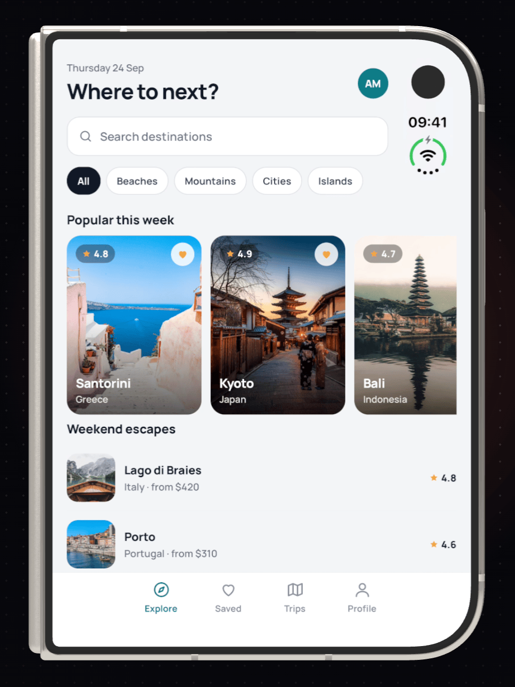
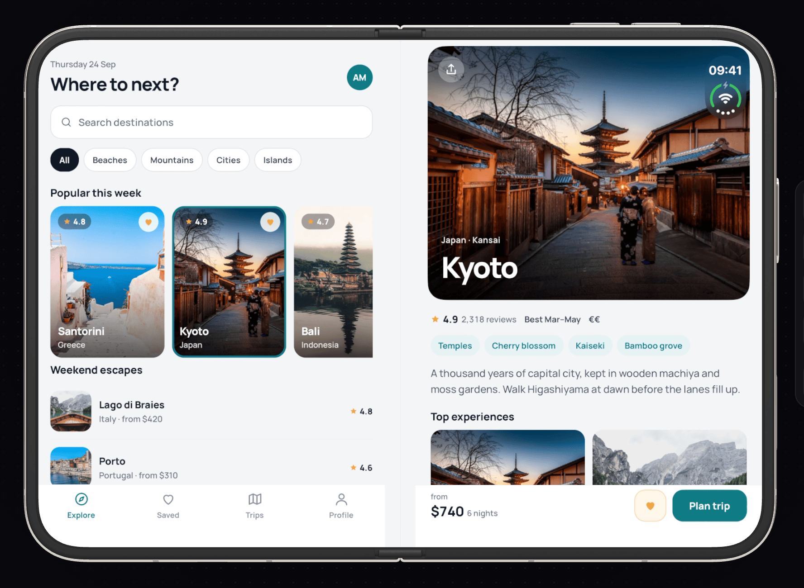

# VibeView agent skills

[](https://www.npmjs.com/package/vibeview)
[](https://github.com/mcp/vibeview/vibeview)

Skills and an MCP server that let a coding agent verify its work on a **live cloud device**: upload a build, start an iOS, Android, Apple TV, Android TV or Roku session, drive the app by UI-tree refs, read logs, take screenshots, and stop when only a human can act.

[VibeView](https://vibeview.io) streams iOS simulators, Android emulators, Apple TV and Android TV simulators, and Roku devices to a browser and to agents. No Mac, no local simulator, no device on the desk. Docs: [AI agent control](https://vibeview.io/docs/agent-control).

<p align="center">
  
</p>

## What your agent can do

- **Check its own change in your React Native app.** It starts `vibeview dev` against your local Metro, so every edit hot-reloads on the cloud device, then it looks at the screen and the logs to see whether the change works.
- **Build the app in the cloud and run that build.** With a shell, it runs `vibeview build --cloud` (no Mac needed for iOS), then starts a device on the finished build.
- **Drive the app like a person.** It reads the screen as a UI tree with short refs (`@e7`), taps, types and swipes by ref, presses TV remote buttons, opens deep links, and takes screenshots.
- **Write and run tests.** It saves plain-language steps as a test, then runs one test or a whole group and reads which step failed and why. AI steps are in beta.
- **Hand off to you** when a step needs a person, such as a login or a payment, with a link to the live session.

It works on iPhone, iPad, Android phones and tablets, Apple TV, Android TV and Roku. You can watch every session live in the dashboard while the agent works.

<table>
  <tr>
    <td width="36%"></td>
    <td></td>
  </tr>
  <tr>
    <td colspan="2"> </td>
  </tr>
</table>

## Install

You need the `vibeview` CLI, logged in:

```bash
npm install -g vibeview
vibeview login
```

Then pick whichever fits your agent.

**Any agent that reads skills** (Claude Code, Cursor, Codex, and others via the `skills` CLI):

```bash
npx skills add vibeview/skills
```

**Claude Code, as a plugin** (installs the skill and registers the MCP server in one step):

```text
/plugin marketplace add vibeview/skills
/plugin install vibeview@vibeview
```

**Claude Code, from the CLI you already installed** (copies the skill into `~/.claude/skills/` and offers to register the MCP server):

```bash
vibeview agent-setup
```

**Any MCP client**: run `vibeview mcp` over stdio.

```json
{
  "mcpServers": {
    "vibeview": { "command": "vibeview", "args": ["mcp"] }
  }
}
```

With Claude Code specifically: `claude mcp add vibeview -- vibeview mcp`.

## What's here

| Path | What it is |
| --- | --- |
| `skills/vibeview-agent/SKILL.md` | The agent workflow: build requirements, the dev loop, verifying with `ui-tree`, screenshots and logs, TV d-pad navigation, the human hand-off rule, cleanup, and the full command reference for both the CLI and MCP. |
| `.claude-plugin/` | Claude Code plugin manifest: the skill plus the `vibeview mcp` server. |
| `.mcp.json` | The same MCP server in the standard root-level form that plugin and MCP directories scan for. |

## Where this comes from

The canonical copy of the skill ships inside the `vibeview` npm package (`vibeview agent-setup` copies it from there). This repository mirrors it so agents and registries can discover it on GitHub. Versions track the CLI.

Issues and questions: support@vibeview.io.
