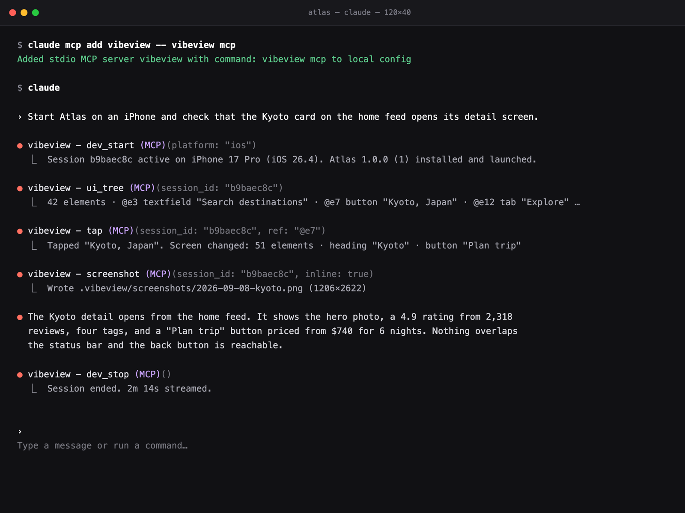
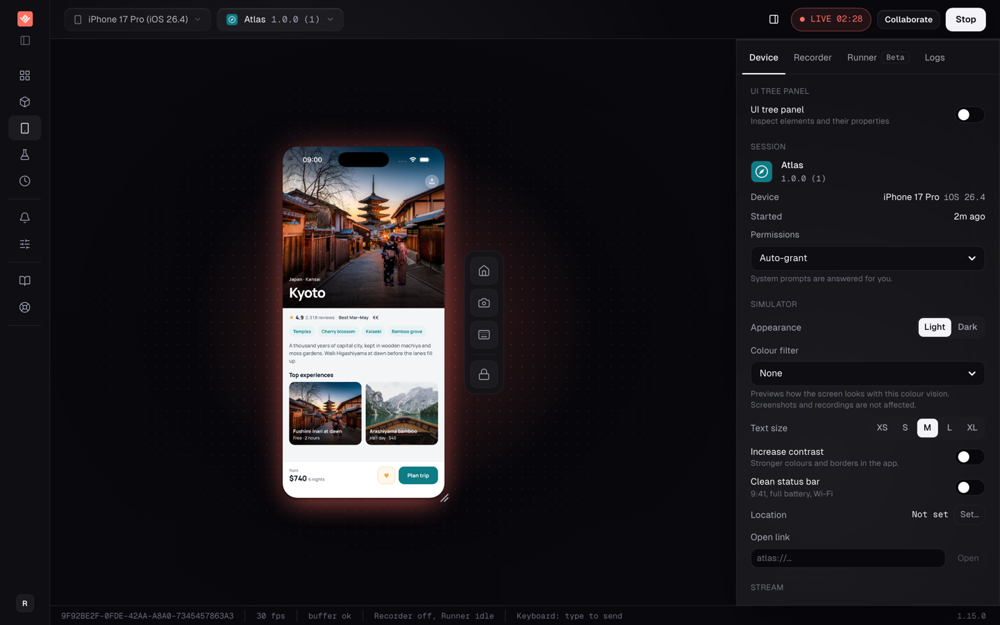
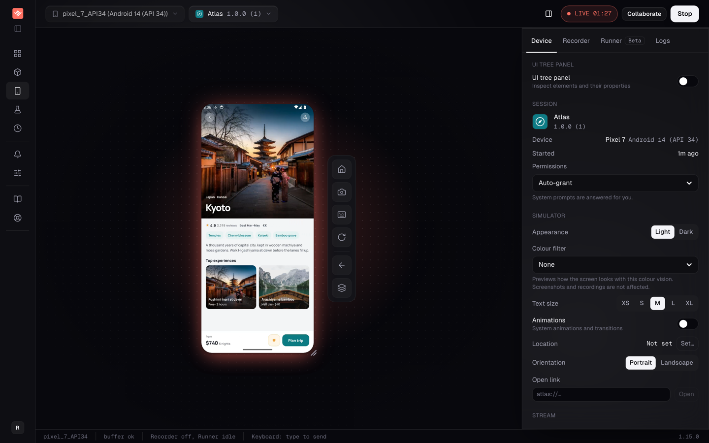
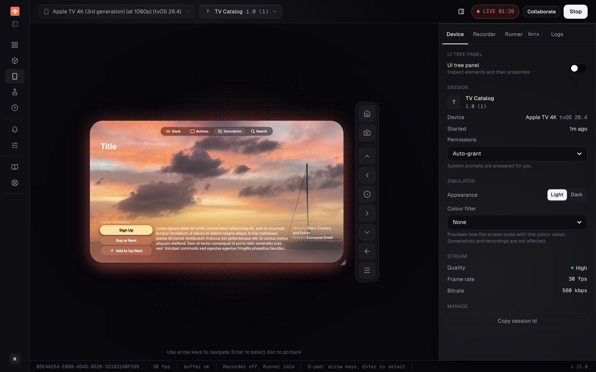
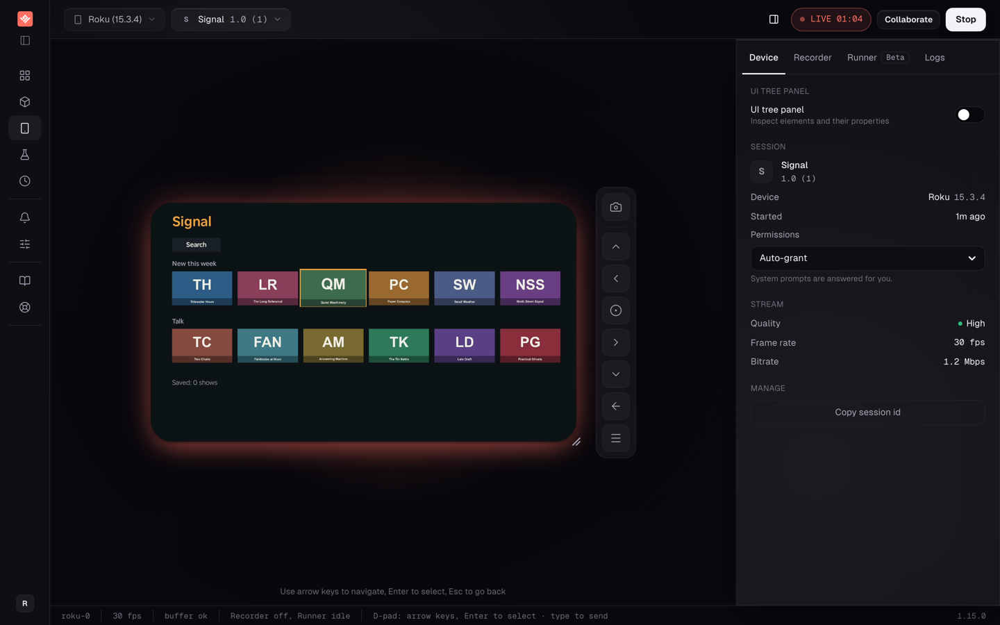

# VibeView agent skills

[](https://www.npmjs.com/package/vibeview)
[](https://github.com/mcp/vibeview/vibeview)

Skills and an MCP server that let a coding agent verify its work on a **live cloud device**: upload a build, start an iOS, Android, Apple TV, Android TV or Roku session, drive the app by UI-tree refs, read logs, take screenshots, and stop when only a human can act.

[VibeView](https://vibeview.io) streams iOS simulators, Android emulators, Apple TV and Android TV simulators, and Roku devices to a browser and to agents. No Mac, no local simulator, no device on the desk. Docs: [AI agent control](https://vibeview.io/docs/agent-control).

<p align="center">
  
</p>

## What your agent can do

- **Start and stop sessions** on iOS, Android, Apple TV, Android TV and Roku, with your app installed and launched.
- **Read the screen as a UI tree** with short refs (`@e7`), then tap, type or swipe by ref. On TVs, press remote buttons.
- **Check the result**: screenshots, app logs, and the tree again after each action.
- **Hand off to you** when a step needs a person, such as a login or a payment, through a link to the live session.

You can watch every session live in the dashboard while the agent works.

<table>
  <tr>
    <td></td>
    <td></td>
  </tr>
  <tr>
    <td></td>
    <td></td>
  </tr>
</table>

## Install

You need the `vibeview` CLI, logged in:

```bash
npm install -g vibeview
vibeview login
```

Then pick whichever fits your agent.

**Any agent that reads skills** (Claude Code, Cursor, Codex, and others via the `skills` CLI):

```bash
npx skills add vibeview/skills
```

**Claude Code, as a plugin** (installs the skill and registers the MCP server in one step):

```text
/plugin marketplace add vibeview/skills
/plugin install vibeview@vibeview
```

**Claude Code, from the CLI you already installed** (copies the skill into `~/.claude/skills/` and offers to register the MCP server):

```bash
vibeview agent-setup
```

**Any MCP client**: run `vibeview mcp` over stdio.

```json
{
  "mcpServers": {
    "vibeview": { "command": "vibeview", "args": ["mcp"] }
  }
}
```

With Claude Code specifically: `claude mcp add vibeview -- vibeview mcp`.

## What's here

| Path | What it is |
| --- | --- |
| `skills/vibeview-agent/SKILL.md` | The agent workflow: build requirements, the dev loop, verifying with `ui-tree`, screenshots and logs, TV d-pad navigation, the human hand-off rule, cleanup, and the full command reference for both the CLI and MCP. |
| `.claude-plugin/` | Claude Code plugin manifest: the skill plus the `vibeview mcp` server. |
| `.mcp.json` | The same MCP server in the standard root-level form that plugin and MCP directories scan for. |

## Where this comes from

The canonical copy of the skill ships inside the `vibeview` npm package (`vibeview agent-setup` copies it from there). This repository mirrors it so agents and registries can discover it on GitHub. Versions track the CLI.

Issues and questions: support@vibeview.io.
